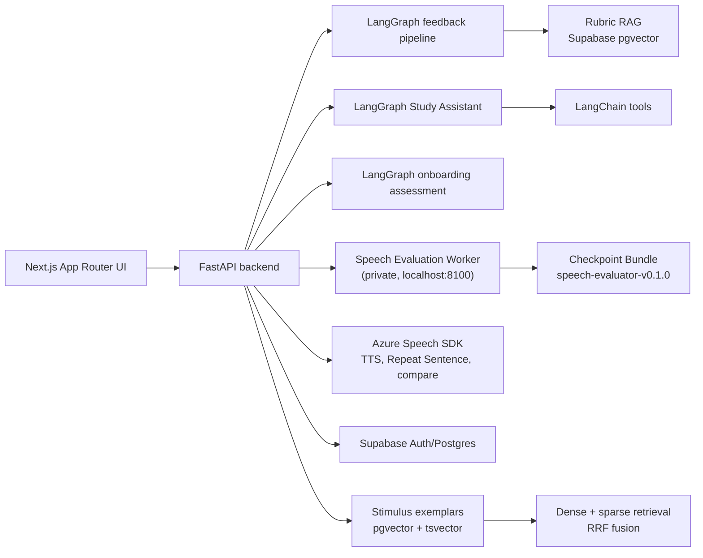
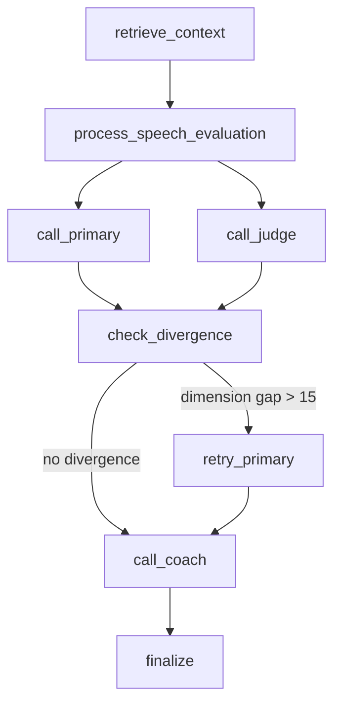

# EchoLingo

EchoLingo is an AI-powered PTE Academic practice platform. It combines
LangGraph agent workflows, rubric-grounded feedback, exemplar-grounded practice
generation, a self-trained Read Aloud Speech Evaluator, and a full-stack web app
for repeatable PTE practice.

This is a personal full-stack / AI agent / speech ML engineering project built
to explore how LLM and speech-model applications can move beyond single API
calls into testable, observable, versioned workflows.

> EchoLingo does not replicate Pearson's official scoring algorithm. Scores and
> feedback are practice-oriented estimates. The 10-90 Read Aloud score is a
> transparently labelled EchoLingo reference scale, not a predicted PTE score.

## Highlights

- 15 PTE Academic task types across Speaking & Writing, Reading, and Listening.
- Full Mock Exam flow with a 15-task sequence and a summary page.
- **EchoLingo Speech Evaluator** for Read Aloud: a multi-task scorer trained on
  frozen Wav2Vec2 features (SpeechOcean762, MFA alignment), exported as an
  immutable Checkpoint Bundle and served by a private Speech Evaluation Worker.
- Provider-neutral Speech Evaluation Result with per-level evidence status
  (sentence / word / phoneme), so missing evidence degrades visibly instead of
  being guessed.
- LangGraph feedback pipeline with RAG, LLM-as-Judge, conditional retry, and
  coach suggestions.
- Study Assistant with LangChain tools for app navigation, practice generation,
  and PTE knowledge Q&A.
- Onboarding assessment agent that scores diagnostic tasks in parallel and
  generates a first-week learning plan.
- Dual retrieval system: scoring rubrics plus stimulus exemplars.
- Theme Practice using pgvector dense retrieval, Postgres full-text search, and
  Reciprocal Rank Fusion in a single SQL query.
- Local originality guard using word-shingle Jaccard overlap to reduce exemplar
  regurgitation.
- Azure Neural TTS for stimuli; Azure Pronunciation Assessment for Repeat
  Sentence and as an explicit Read Aloud comparison baseline.
- FastAPI as the single authoritative backend; Next.js calls the Python backend
  directly.
- Broad test coverage: backend pytest, frontend unit tests, Playwright E2E
  tests, and a separate pytest suite for the speech package.

## Tech Stack

**Web:** Next.js 16 (App Router), React 19, TypeScript, Tailwind CSS 4

**Backend & agents:** FastAPI, LangGraph, LangChain, Supabase
PostgreSQL/pgvector, DashScope Embeddings, Azure Speech SDK

**Speech Evaluator:** PyTorch, `facebook/wav2vec2-base-960h` (pinned revision),
Montreal Forced Aligner, MLflow, uv

**Testing:** pytest, Vitest, Playwright, ruff

**Development workflow:** Claude Code with ECC-assisted planning, verification,
review, and documentation. Product scope and architecture decisions remain
explicit repository artifacts rather than session-only context.

## Product Scope

EchoLingo supports these PTE Academic practice flows:

| Area | Features |
| --- | --- |
| Practice | Individual task practice, Theme Practice, Targeted Practice |
| Mock Exam | 15-task sequence covering all implemented PTE task types |
| Feedback | Structured AI feedback, dimension scores, suggestions, coach tips |
| Speech | Read Aloud via EchoLingo Speech Evaluator; Repeat Sentence via Azure; Azure TTS stimuli |
| Study Aid | Study Assistant, word lookup, vocabulary list |
| Progress | History, task-type weakness profile, trends, recommendations |
| Platform | Supabase auth/sync, i18n, PWA, responsive UI |

Implemented task types:

- Read Aloud
- Repeat Sentence
- Answer Short Question
- Summarize Written Text
- Write Essay
- Personal Introduction
- Describe Image
- Re-tell Lecture
- Fill in the Blanks (Reading)
- Re-order Paragraphs
- Multiple Choice (Reading)
- Summarize Spoken Text
- Fill in the Blanks (Listening)
- Highlight Correct Summary
- Write from Dictation

Task type metadata (section, route, timing, scoring dimensions, Mock Exam order)
lives in one shared catalogue, `src/data/task-types.json`, read by both the
frontend and the backend.

## Architecture



The frontend does not own LLM, speech, or third-party business logic. All
secrets and agent orchestration live in the Python backend. Browser requests go
through the FastAPI base URL configured by `NEXT_PUBLIC_API_BASE_URL`. The
Speech Evaluation Worker is a separate private process; FastAPI is its only
client.

## Speech Evaluation

### Runtime

Recorded spoken answers go through one request, `POST /api/pte/spoken-feedback`,
which returns both a Speech Evaluation Result and the LLM feedback.

| Task | Provider | Scale |
| --- | --- | --- |
| Read Aloud | EchoLingo Speech Evaluator (default `echolingo` mode) | 10-90 reference scale, with Spoken Task Score Estimate |
| Read Aloud, `compare` mode | EchoLingo result plus Azure on the same recording | EchoLingo 10-90, Azure 0-100 |
| Repeat Sentence | Azure Pronunciation Assessment | 0-100 |
| Other spoken tasks | STT + LLM feedback | — |

- `backend/services/speech_evaluation.py` defines the provider-neutral result
  (`scale`, per-level `evidenceStatus`, `modelId`, `warnings`) with EchoLingo
  and Azure adapters.
- `backend/services/speech_worker.py` is the Worker HTTP client
  (`SPEECH_WORKER_URL`).
- `backend/services/speech_normalization.py` maps the Worker's raw label-scale
  scores to 10-90 through a per-bundle file in `backend/data/speech_calibration/`
  and applies the Read Aloud Content policy (ADR-0016).
- If the Worker is unavailable, Read Aloud reports an explicit evaluation
  failure. Azure is never a silent fallback (ADR-0012).
- Multi-sentence Read Aloud passages are cut at their aligned sentence spans
  and scored per sentence.

### Evaluator Model

The evaluator lives in `speech/` as an independent Python package; `backend/`
never depends on PyTorch, CUDA, MFA, or MLflow.

- Frozen `wav2vec2-base-960h` encoder, weighted mix of layers 4/6/8/10/12,
  canonical phone identities, standardized acoustic features, and multi-task
  heads for sentence, word, and phoneme scores.
- Trained on SpeechOcean762 with a speaker-independent split and expert-mean
  targets, plus feature masks and offline audio augmentation (candidate 3.2c).
- Sealed test set (seed 42): sentence Accuracy / Fluency Pearson 0.71 / 0.79,
  word error detection Macro F1 0.68 (no-learning baseline 0.48). Adult
  speakers are scored much better than children (sentence Accuracy 0.81 vs
  0.38).
- Training runs on a rented Linux GPU (ADR-0014); inference runs on the
  development Mac CPU (ADR-0015, median latency about 3 s).

Roadmap status: M0–M5 are complete (Read Aloud runs on the evaluator by
default), and M6 (word/fluency annotations, Compare developer panel,
comparison persistence) is in progress. See `docs/SPEECH_EVALUATOR_ROADMAP.md`.

## Agent Workflows

### 1. Feedback Scoring Pipeline

Implemented in `backend/services/feedback_graph.py`.



Key behavior:

- Retrieves scoring rubric context before the primary scoring call.
- Adds the Speech Evaluation Result as context for spoken tasks.
- Runs Primary and Judge LLM calls in parallel.
- Detects dimension-level score divergence above 15 points.
- Retries the primary scoring call once when divergence is detected.
- Calls a coach node with tools for historical weaknesses and rubric lookup.
- Emits structured feedback, `judgeLog`, `coachSuggestions`, and per-request
  observability logs such as `task_type`, `rag_chars`, `diverged`, and
  `retry_count`.

All model clients are built in `backend/services/llm_chain.py`, which provides
plain-text, JSON-parsing, and bounded tool-calling loops.

### 2. Study Assistant

Implemented in `backend/services/study_assistant_graph.py` and
`backend/tools/study_assistant_tools.py`.

The Study Assistant is a multi-turn tool-using helper with three LangChain
tools:

- `navigate_app`: returns app navigation help from an allow-listed route map.
- `generate_practice`: creates deep links into topic-based text task practice.
- `pte_knowledge`: answers PTE format, scoring, timing, and strategy questions.

The tool loop is capped at four iterations. Routes are filtered through an
allow-list so the model cannot invent application paths. Topic practice defaults
to exemplar-grounded generation and switches to news-grounded generation only
when the latest user message contains an explicit recency cue.

### 3. Onboarding Assessment

Implemented in `backend/services/onboarding_graph.py`.

The onboarding graph:

1. Scores multiple diagnostic responses in parallel with `asyncio.gather`.
2. Synthesizes a section-level weakness profile with an LLM.
3. Generates a personalized first-week learning plan.

## RAG and Retrieval

EchoLingo uses two retrieval surfaces:

| Collection | Purpose | Implementation |
| --- | --- | --- |
| Rubric chunks | Ground feedback in task-specific scoring criteria | Supabase pgvector via `backend/services/rag.py` |
| Stimulus exemplars | Seed realistic practice stimulus generation | Dedicated Postgres table with pgvector + `tsvector` |

Theme Practice uses hybrid retrieval:

- dense similarity: pgvector cosine distance over DashScope 1024-dim embeddings
- sparse retrieval: Postgres full-text search with `tsvector`
- fusion: Reciprocal Rank Fusion
- execution: single SQL query in `backend/services/exemplar_store.py`

Generated stimuli pass through a local originality guard in
`backend/services/originality.py`. It computes 4-gram word-shingle Jaccard
overlap against injected exemplars and triggers one regeneration if overlap is
above `0.5`.

## Repository Structure

```text
backend/
  main.py                    FastAPI app entry point
  routers/                   HTTP endpoints
  services/                  Agent graphs, RAG, speech evaluation, stimulus generation
  tools/                     LangChain tools
  prompts/                   YAML prompts and knowledge files
  data/speech_calibration/   Per-bundle 10-90 normalization files
  scripts/                   Rubric/exemplar ingestion and evaluation scripts
  tests/                     pytest suite

src/
  app/                       Next.js App Router pages
  components/                Shared UI components
  data/task-types.json       Shared Task Type Catalogue (frontend + backend)
  hooks/                     Practice task run and recording lifecycle hooks
  lib/                       API client, synced store, history, recommendations
  locales/                   English and Chinese UI strings
  types/                     Shared TypeScript types

speech/                      EchoLingo Speech Evaluator (separate uv package)
  configs/                   Encoder, dataset, training, and runtime configs
  src/echolingo_speech/      Data, alignment, features, models, training,
                             evaluation, bundles, worker
  tests/                     Speech package pytest suite
  docs/                      Milestone acceptance and diagnostics reports

docs/
  adr/                       Architecture decision records
  PROJECT_CONTEXT.md         Current project context and architecture notes
  ROADMAP.md                 Current phase and strategic priorities
  SPEECH_EVALUATOR_ROADMAP.md  Speech Evaluator plan and execution checklist
  DEPLOYMENT.md              Environments and deployment
  DEVELOPMENT_LOG.md         Development log
```

## Getting Started

### Prerequisites

- Node.js 20+
- Python 3.11+
- Supabase project with required migrations applied
- OpenAI-compatible chat model credentials
- DashScope API key for embeddings
- Azure Speech Services key and region for TTS, Repeat Sentence, and compare
  mode
- For Read Aloud scoring: [uv](https://docs.astral.sh/uv/), a conda env named
  `aligner` with Montreal Forced Aligner, and a local Checkpoint Bundle (not in
  Git; see `speech/README.md`)

### Frontend Setup

```bash
npm install
cp .env.example .env.local
```

Frontend environment:

```env
NEXT_PUBLIC_SUPABASE_URL=
NEXT_PUBLIC_SUPABASE_ANON_KEY=
NEXT_PUBLIC_API_BASE_URL=http://localhost:8000

# Optional developer switch: Read Aloud also runs Azure as a comparison baseline
NEXT_PUBLIC_SPEECH_EVALUATION_COMPARE=
```

Run the frontend:

```bash
npm run dev
```

### Backend Setup

```bash
cd backend
python -m venv .venv
source .venv/bin/activate
pip install -r requirements.txt
cp .env.example .env
```

Backend environment (see `backend/.env.example` for the full list):

```env
LLM_API_KEY=
LLM_BASE_URL=https://api.deepseek.com
LLM_MODEL=deepseek-chat

AZURE_SPEECH_KEY=
AZURE_SPEECH_REGION=

SPEECH_WORKER_URL=http://localhost:8100
SPEECH_WORKER_TIMEOUT_SEC=30

SUPABASE_URL=
SUPABASE_ANON_KEY=
SUPABASE_SERVICE_ROLE_KEY=
SUPABASE_DB_URL=

DASHSCOPE_API_KEY=
DASHSCOPE_BASE_URL=https://dashscope.aliyuncs.com/compatible-mode/v1

GNEWS_API_KEY=

CORS_ORIGINS=http://localhost:3000
```

Run the backend:

```bash
uvicorn main:app --reload --host 0.0.0.0 --port 8000
```

### Speech Evaluation Worker

Read Aloud needs the Worker running. With the speech environment and a bundle
set up as described in `speech/README.md` ("M4"):

```bash
cd speech
cp configs/speech.example.yaml configs/speech.yaml   # data_root, artifact_root, worker_bundle_id
uv sync --frozen --python 3.11
uv run python -m echolingo_speech.worker.app serve --config configs/speech.yaml
curl -s localhost:8100/health
```

Then open the frontend at `http://localhost:3000`.

## Useful Commands

```bash
# Frontend quality gates
npm run lint
npm run typecheck
npm run test:unit:run
npm run build
npm run test:e2e

# Backend
cd backend
ruff check .
pytest tests/ -v --tb=short

# Speech package
cd speech
uv run ruff check src/ tests/
uv run pytest tests/ -v -m "not network"
```

## Supabase and Data Setup

Database schema and migrations live at the repository root:

- `supabase-schema.sql`
- `supabase-migration-001.sql` through `supabase-migration-006.sql`

RAG-related setup:

- `backend/scripts/setup_pgvector.sql` enables pgvector-related database setup.
- `backend/scripts/seed_rubrics.py` embeds rubric YAML files into the rubric
  vector store.
- `backend/scripts/embed_exemplars.py` embeds accepted stimulus exemplars into
  the hybrid retrieval table.

Some exemplar source data is intentionally gitignored. The code supports both
public-source scraping and private local recall-question ingestion, but private
data is not committed. Speech datasets, feature caches, checkpoints, MLflow
runs, and Checkpoint Bundles also stay outside Git under the configured
`data_root` / `artifact_root`.

## Documentation

The most useful project docs are:

- `docs/README.md` for the documentation map and maintenance policy.
- `docs/PROJECT_CONTEXT.md` for the current architecture and domain model.
- `docs/ROADMAP.md` for the current phase and strategic priorities.
- `docs/SPEECH_EVALUATOR_ROADMAP.md` and `speech/README.md` for the Speech
  Evaluator plan, training, bundles, and Worker.
- `docs/adr/README.md` for the full decision index, including:
  - `0005` LangGraph + rubric RAG feedback pipeline
  - `0008` / `0009` exemplar-grounded generation and hybrid retrieval
  - `0010` Study Assistant tools and boundaries
  - `0011`–`0016` Speech Evaluator: pretrained encoder, switchable providers,
    separate Worker, rented-GPU training, Worker on the development Mac, and
    per-bundle 10-90 normalization

## Current Limitations

- Scores are practice estimates, not official Pearson PTE scores. The Read
  Aloud 10-90 scale is provisional until an independent PTE-specific benchmark
  supports calibration.
- The Speech Evaluator is trained on SpeechOcean762 sentences; it scores
  children's speech noticeably worse than adults', and has no benchmark for
  non-English or off-passage speech beyond the Content coverage gate.
- The Worker currently runs only on the development Mac; Read Aloud scoring is
  unavailable wherever the Worker is not running.
- Repeat Sentence still uses Azure and needs its own labels and calibration
  before moving to the EchoLingo evaluator.
- Azure, LLM, DashScope, and Supabase-backed features require valid credentials.
- CI-style tests should mock external paid APIs; do not run E2E against real LLM,
  Azure, Supabase, or paid external services.
- Payments, subscriptions, social features, and commercialization flows are
  intentionally outside the current runtime scope.

## License

This repository is currently a personal portfolio project. Add a license before
using it as an open-source dependency or redistributing it.
