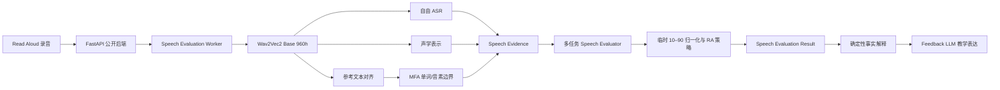

# EchoLingo Read Aloud Speech Evaluator 路线图

状态：M0–M5 已完成（M3 定稿候选 3.2c 导出为 Bundle `speech-evaluator-v0.1.0`，由本机私有 Worker 服务，Read Aloud 默认使用）；M6 反馈与诊断进行中，见第 18 节  
更新日期：2026-10-30  
范围：第一代仅覆盖 PTE Academic Read Aloud  
优先级：先完成 Speech Evaluator，再启动 PTE Task Calibrator 与 Native Speech Model

## 1. 目标

第一代模型不是从零预训练语音基础模型，也不宣称生成官方 PTE 分数。它要完成一个真实、可训练、可验证的闭环：从 Read Aloud 录音中提取语音证据，学习句子、单词和音素层级的发音表现，输出 EchoLingo 10–90 参考评价，并在应用中替换 Read Aloud 的默认 Azure 评分路径。

第一代必须做到：

- EchoLingo 自己训练并拥有语音适配参数和多任务评分参数；
- 评分证据覆盖 Pronunciation、Oral Fluency、Content、单词和内部音素层级；
- 分数、证据、解释和模型来源可以追溯；
- 失败时明确拒绝评分，不生成看似可信的虚假结果；
- Azure 只在显式 Compare 模式中作为外部基线；
- 第一阶段完成后，结果可直接成为未来 PTE Tutor 的辅导上下文。

## 2. 非目标

第一代不包含：

- 从零训练 Wav2Vec2 或其他语音基础模型；
- 真实 PTE 10–90 分校准或官方等效声明；
- PTE Task Calibrator；
- Repeat Sentence 自研评分；
- 面向真实用户的生产 SLA；
- Native Speech Model、Tutor Conversation 或原生语音到语音训练；
- 把 Azure、竞品分数或整场官方 PTE 成绩当作单题训练真值。

## 3. 总体架构



### 3.1 明确的组件边界

| 组件 | 责任 | 不负责 |
|---|---|---|
| Wav2Vec2 Base 960h | 逐帧语音表示、CTC 转写概率 | PTE 分数 |
| 自由 ASR | 模型在不知道原文时实际听到的内容 | 单独决定 Content |
| 参考文本对齐 | 漏词、加词、重复、单词时间 | 判断发音好坏 |
| MFA | 第一代 ARPA 音素时间定位 | 发音评分真值 |
| Speech Evaluator | 句子、单词、音素、流利度与韵律预测 | 自由生成教学文案 |
| Provisional Score Normalization | 学习阶段 10–90 单调映射 | 声称对应真实 PTE |
| FastAPI | 鉴权、模式路由、公共契约、结果适配 | 加载 CUDA 模型 |
| Speech Evaluation Worker | 加载指定 Bundle 并执行 GPU 推理 | 对浏览器公开 |
| Feedback LLM | 基于固定事实组织建议 | 修改分数或发明错误 |

## 4. 数据策略

### 4.1 Foundational Speech Labels

[SpeechOcean762](https://github.com/jimbozhang/speechocean762) 是第一代评分监督锚点：

- 5,000 条非母语英语录音；
- 250 名普通话母语说话人，成人与儿童各约一半；
- 5 名专家分别评分；
- 句子级 Accuracy、Fluency、Completeness、Prosodic 与 Total；
- 单词级 Accuracy、Stress 与 Total；
- 音素级 0–2 评分和部分误读音素；
- CC BY 4.0，可用于商业与非商业用途。

官方训练与测试部分保持隔离。训练部分再按说话人划出 Validation，官方 Test 作为封存基准，不用于学习率、轮次、权重或阈值选择。

### 4.2 广泛语音适配

[Loquacious Small](https://huggingface.co/datasets/speechbrain/LoquaciousSet) 作为第一阶段唯一广泛语音适配池：

- 250 小时英语音频与转写；
- 包含朗读、自然语音、干净与噪声环境；
- 来源包括 VoxPopuli、LibriHeavy、YODAS、The People's Speech 和 Common Voice 18.0 等；
- 只用于 CTC ASR/对齐适配，不提供发音或 PTE 评分监督。

Common Voice 不再默认单独追加，因为 Loquacious 已包含 Common Voice 18.0。未来目标口音增量必须先完成来源、说话人和音频指纹去重。

### 4.3 数据仓库

```text
speech-data/
├─ raw/                 # 原始发布，只读
├─ processed/           # 可重建音频、MFA、特征
├─ benchmarks/          # 封存基准
└─ consented/           # 未来获授权的 EchoLingo 录音
```

每个 Speech Dataset Manifest 记录：

- 样本身份与文件哈希；
- 数据集和发布版本；
- 来源与许可；
- 说话人及 Training/Validation/Test 分区；
- 数据用途和未来用户数据的同意类别；
- 派生步骤与生成代码版本。

大型音频、特征缓存和权重不进入普通 Git。

## 5. 模型设计

### 5.1 第一代底座

固定使用 [`facebook/wav2vec2-base-960h`](https://huggingface.co/facebook/wav2vec2-base-960h)：

- Apache 2.0；
- CTC 输出可支持自由转写与参考文本对齐；
- 隐藏层提供逐帧声学表示；
- 尺寸适合 RTX 4070 12 GB 冻结训练和局部适配。

Whisper 保留为未来 ASR 对照，WavLM 保留为未来表示对照，不进入第一轮混合基线。

### 5.2 三层特征聚合

```text
Wav2Vec2 逐帧表示
├─ 音素区间池化 → 内部音素评分头
├─ 单词区间池化 → 单词 Accuracy / Stress 头
└─ 注意力统计池化 → 句子 Accuracy / Fluency / Prosody / Completeness 头
```

同时拼接可解释特征：

- 停顿次数、总占比与最长停顿；
- 发音时长、每秒单词数；
- 重复、假启动和自我修正；
- 音高与能量变化；
- 词间时长稳定性。

### 5.3 多任务损失

第一代固定起点：

```text
L_total
= 0.45 × L_sentence
+ 0.30 × L_word
+ 0.25 × L_phone
```

规则：

- 标签尺度先标准化；
- 每层级在有效标签内求平均；
- 低质量或失败音素对齐通过 Mask 排除；
- 长句不能因为音素更多而主导梯度；
- 权重只使用 Validation 调整；
- 动态权重只能作为独立候选实验。

### 5.4 音素能力

第一阶段使用 [MFA English US ARPA](https://mfa-models.readthedocs.io/en/latest/acoustic/English/English%20%28US%29%20ARPA%20acoustic%20model%20v2_0_0a.html) 生成离线音素边界。其输出只负责定位；SpeechOcean 专家标签才是评分监督。

运行时第一代也使用 MFA 以保持训练/推理一致：

- 音素对齐成功：可生成内部音素证据；
- 音素对齐失败：降级到句子与单词评价；
- 最低句子或单词证据不足：拒绝评分。

默认用户界面不展示完整音素列表。

## 6. 训练实验顺序

### A0：冻结基础评分基线

- 完整冻结 Wav2Vec2；
- 使用 SpeechOcean 官方聚合标签；
- 训练多任务评分网络；
- 不使用 Loquacious、LoRA 或动态损失；
- 建立可复现的最低基线。

### A0-Rater：评分者分歧候选

- 使用 `scores-detail.json` 中 5 名专家的原始评分；
- 内部学习中心分数和评分分歧；
- 不向用户显示置信度或分歧；
- 只有基准提升才替换 A0 聚合标签方案。

### A0-Aug：轻量增强候选

允许：轻度噪声、音量、房间响应、编码效果和保守特征 Mask。  
禁止：明显变速、变调、裁剪、TTS 高分样本和继承原标签的合成错误。

### A1-Encoder：Loquacious CTC Adapter

- 使用 Loquacious 音频与转写训练 CTC LoRA/Adapter；
- 验证 WER、对齐覆盖和噪声鲁棒性；
- 不将 Loquacious 作为评分标签。

### A1-Scorer：适配表示上的评分候选

- 加载 A1 Encoder；
- 冻结大部分编码器；
- 使用 SpeechOcean 训练评分头；
- 与 A0 使用同一个封存 Speech Evaluation Benchmark 比较。

### 成人目标域候选

- 成人与儿童都参与基础监督；
- Batch 平衡年龄组；
- 成人测试结果是主要升级指标；
- 比较“全体训练”与“全体训练后成人轻微微调”；
- 年龄不作为线上评分输入。

## 7. 评估与验收

### 7.1 多指标基准

句子级：Pearson、Spearman、MAE、分数段误差。  
单词/音素级：MAE、错误检测 Precision/Recall、Macro F1。  
证据链：WER、单词对齐成功率、音素对齐合格率。  
鲁棒性：干净、噪声、混响、异常与截断音频。  
分组：成人/儿童、性别、说话人与其他可用元数据。

任何单一指标都不能独立决定模型升级。

### 7.2 Speech Evaluator Acceptance

个人开发环境默认启用的最低门槛：

- 数据和说话人隔离审计通过；
- 两次等价训练结果合理稳定；
- 句子 Accuracy 和 Fluency 与封存专家标签相关系数均至少 0.60；
- 句子、单词与音素预测优于无学习基线；
- 异常音频、非英语和对齐失败安全处理；
- Azure Compare Adapter 仍可工作。

这些是个人学习阶段工程门槛，不代表 PTE 校准完成或可公开发布。

### 7.3 有效性边界

- SpeechOcean 的评分有效性主要覆盖普通话母语英语学习者；
- Loquacious 可以提高识别鲁棒性，但不能证明跨口音评分公平；
- 第一代不把地区口音本身当作错误；
- 未来跨口音有效性必须依赖带人工标签的独立分组基准。

## 8. 10–90 参考评价

在 PTE Task Labels 不足时，保留模型原始尺度，并通过单调 Provisional Score Normalization 显示 10–90：

```text
RA 参考总分
= 40% Pronunciation
+ 40% Oral Fluency
+ 20% Content
```

Content 同时执行门控：

- 无有效语音或完整非英语响应：返回最低结果；
- 几乎没有读出原文：严重封顶；
- 只读出少量内容：限制最高结果；
- 大部分内容有效：按三个维度正常计算。

该公式明确标注为 EchoLingo 学习阶段策略，不声称是 Pearson 公式。

## 9. 运行与部署

### 9.1 训练环境

标准语音训练环境是一台 **Linux GPU 机器**（ADR-0014）。当前使用按量租用的云 GPU 实例（Ubuntu，单卡 24 GB 级别）；原 WSL2 Ubuntu + RTX 4070 环境已不可用，仅作为历史记录保留在 ADR-0013 与 `DEVELOPMENT_LOG.md`。

- PyTorch CUDA、Transformers、MFA、MLflow 和 Worker 留在独立于 `backend/` 的环境；
- `speech.yaml` 的 `data_root` / `artifact_root` 指向实例的持久数据盘，不放系统盘；
- 实例可能被释放：manifest、MLflow 记录、检查点和基准结果必须在每个阶段结束后备份到实例之外，原始数据与特征缓存可以按 `speech/README.md` 重建；
- 换机器后先复现上一阶段基线，再继续新实验；
- 12 GB 显存足够冻结编码器的评分头训练；A1 的 CTC LoRA/Adapter 训练建议 24 GB。

第 9.2 节的本机端口布局只描述个人开发时的进程边界。开发阶段 Worker 运行在本机 Mac 的 CPU 上（ADR-0015，M4 决定），训练仍在租用的 GPU 上，两台机器之间只交换 Checkpoint Bundle。

### 9.2 进程边界

```text
Next.js                 http://localhost:3000
FastAPI                 http://localhost:8000
Speech Evaluation Worker http://localhost:8100
MLflow UI               http://localhost:5000
```

端口均可配置，端口不是模型身份。

### 9.3 Checkpoint Bundle

每个通过验收的模型导出不可变 Bundle：

```text
speech-evaluator-v0.1.0/
├─ scoring-head.safetensors
├─ adapter.safetensors
├─ model-config.json
├─ feature-schema.json
├─ label-schema.json
├─ normalization.json
├─ training-manifest.json
├─ dataset-manifest.json
├─ benchmark-results.json
└─ LICENSES.md
```

Worker 只能加载明确配置的 Bundle，不能自动加载“最新文件”。`bundle.json` 记录其余每个文件的 SHA-256，导出拒绝覆盖已有版本，加载拒绝任何与清单不符的文件。第一代 Bundle 没有 Adapter（A1 未采纳），所以不含 `adapter.safetensors`。

### 9.4 实验追踪

所有 Evaluator Training Run 进入本地 MLflow，记录数据清单、Git commit、随机种子、超参数、训练曲线、多指标结果、GPU、训练时间与峰值显存。只有通过验收的 Run 能导出 Bundle。

## 10. 应用集成

### 10.1 代码组织

```text
speech/
├─ configs/
├─ src/echolingo_speech/
│  ├─ data/
│  ├─ alignment/
│  ├─ features/
│  ├─ models/
│  ├─ training/
│  ├─ evaluation/
│  ├─ bundles/
│  └─ worker/
└─ tests/
```

现有 `backend/` 只增加轻量 HTTP Client、Provider Adapter 与模式编排，不安装 PyTorch、CUDA、MFA 或 MLflow。

### 10.2 Speech Evaluation Result

新接口使用提供方无关契约：

```json
{
  "taskType": "read_aloud",
  "provider": "echolingo",
  "taskScore": 74,
  "dimensions": {
    "pronunciation": 72,
    "oralFluency": 68,
    "content": 91
  },
  "recognizedText": "...",
  "words": [],
  "evidenceStatus": {
    "sentence": "available",
    "word": "available",
    "phoneme": "available"
  },
  "label": "EchoLingo参考评价"
}
```

旧 Azure `/api/pronunciation` 契约已于 2026-10-13 删除：前端改用 `POST /api/pte/spoken-feedback`，由 `backend/services/speech_evaluation.py` 把 Azure 结果转换为 provider-neutral 的 Speech Evaluation Result。M4 的 Worker 返回私有结果（`speech/src/echolingo_speech/worker/schema.py`）：分数保持标签原始尺度，句子、单词、音素各带证据状态。M5 起 `from_echolingo` 把它映射到公共契约（`backend/models/schemas.py`）：上面示例中的 `taskScore`、`dimensions`、`evidenceStatus` 对应字段 `taskScoreEstimate`、`pronunciation` / `oralFluency` / `content`、逐层 `evidenceStatus`（状态加原因），另有 `scale`（EchoLingo `10-90`，Azure `0-100`）、`modelId`（Bundle）与 `warnings`；无法支持的维度为 null。参考评价标签由前端按 `scale` 显示。

### 10.3 Read Aloud 模式

`echolingo`：默认，只运行自研模型，失败明确返回，不自动 Azure 回退。  
`compare`：显式运行 EchoLingo 与 Azure，开发者查看并列诊断。

Repeat Sentence 暂时保持现有 Azure Pronunciation Assessment；Azure TTS 不受影响。

### 10.4 延迟与失败

- 第一代同步请求预算为 30 秒；
- Worker 启动时加载模型；
- Compare 并行调用两个 Provider；
- 单方失败可返回 Partial；
- MFA 临时文件始终清理；
- 只有实测延迟证明同步不足时才引入队列或流式进度协议。

## 11. 用户反馈设计

普通 Read Aloud 页面只展示一套主结果：

- Pronunciation、Oral Fluency、Content、RA 参考总分；
- 所有可靠低分单词标红；
- 漏词、错词、加词与重复具有不同状态；
- 所有显著流利度问题在对应位置标识；
- 点击低分单词显示单词分和简短、可支持的问题类别；
- 不展示完整音素列表；
- 页面顶部提供少量优先练习摘要。

内部保留完整音素分、音素区间、对齐质量和原始模型输出。

开发者 Compare 面板展示：

- 两个 Provider 的维度分和差值；
- 双方识别文本；
- 单词判断分歧；
- EchoLingo 对齐状态；
- Provider 延迟与错误。

## 12. 解释权限

```text
Speech Evaluator
→ 固定分数和结构化事实

确定性解释层
→ 将事实转成可核查描述

Feedback LLM
→ 组织教学语言与建议
```

LLM 不得：

- 修改任何分数；
- 新增未检测到的单词或音素错误；
- 把缺失证据描述成已确认事实；
- 声称结果是官方 PTE 分数。

## 13. Compare 数据与隐私

默认保存结构化比较结果、差值、证据状态、Checkpoint ID、时间与不可逆录音哈希。默认不保存原始音频、逐帧特征、可复用声音向量、MFA 临时文件或重复题目文本。

开发者可以显式限时保留自己的调试录音。未来任何用户原始音频保留和模型训练都需要独立 Training Consent。

## 14. 实施里程碑

### M0：环境与骨架

- WSL2 GPU 验证；
- `speech/` 包骨架；
- 数据和 Artifact 根目录；
- MLflow 本地追踪；
- 单元测试与配置校验。

### M1：SpeechOcean 数据管线

- 下载、校验与许可清单；
- 固定说话人切分；
- MFA 对齐和质量报告；
- 特征提取；
- 封存基准锁定。

### M2：A0 冻结基线

- Wav2Vec2 特征；
- 三级池化；
- 多任务评分头；
- 固定损失；
- 两次稳定训练；
- 多指标基准报告。

### M2.5：A0 基线修复

- 在新训练环境复现 A0 两个种子；
- 单词/音素级诊断与可视化报告；
- 逐项修复第 18.2 节列出的缺陷，每项单独与 A0 对照；
- 单词级错误检测超过无学习基线，句子级不回退。

### M3：候选改进

- 评分者分歧候选；
- 轻量增强候选；
- 成人目标域候选；
- Loquacious CTC Adapter 与 A1 Scorer；
- 只保留被基准支持的改进。

### M4：Bundle 与 Worker

- Bundle 导出、校验和加载；
- 私有 Worker；
- 启动加载、健康检查和超时；
- 句子/单词/音素分层降级。

### M5：FastAPI 与 Read Aloud

- Provider-neutral V2 契约；
- EchoLingo Provider Client；
- Azure Compare Adapter；
- Read Aloud 默认 EchoLingo；
- 旧 Azure 专用契约迁移。

### M6：反馈与诊断

- 单词级完整标注；
- 流利度事件标注；
- 重点建议摘要；
- Compare 开发者面板；
- 结构化比较持久化与隐私清理。

## 15. 第一代正式完成定义

第一代只有在以下全部完成后才算完成：

- SpeechOcean 数据、许可、固定切分、MFA 与泄漏审计完成；
- A0 多任务模型和至少两个稳定 Run 完成；
- A1 Loquacious 候选完成并与 A0 比较；
- 达到 Speech Evaluator Acceptance；
- 通过验收的 Run 导出完整 Checkpoint Bundle；
- Worker 在配置的 GPU 环境上运行；
- FastAPI 和 Read Aloud V2 接入完成；
- EchoLingo-only 与显式 Compare 行为正确；
- 完整单词和流利度标注完成；
- Compare 开发者面板完成；
- 自动化测试、基准报告和限制说明齐全。

## 16. 后续阶段

### PTE Task Calibrator

只有获得足够、合法、任务级、覆盖目标人群的 PTE Task Labels 后才启动。第一代 Calibrator 是独立小模型，基础 Speech Evaluator 先冻结；它必须在独立 PTE 黄金基准上超过 40/40/20 临时策略。

具体最低样本数量尚未最终确认，不把 Azure、竞品分数或整场 PTE 成绩替代为任务级真值。

### Native Speech Model

在 Speech Evaluator 完成后启动。它读取已接受的 Speech Evaluation Result 进行 Tutor Conversation，不重新生成另一套发音分数；Tutor Goal、Tutor Check、Recovery Segment、固定国际英语 Tutor Voice 与原生语音到语音训练属于后续独立路线。

## 17. 主要风险

| 风险 | 应对 |
|---|---|
| SpeechOcean 训练录音较少 | 冻结底座、小评分头、严格封存测试 |
| 一半为儿童 | 全体训练、成人主指标、成人候选微调 |
| 全部为普通话母语者 | 限定有效性声明，未来补充带标签跨口音基准 |
| MFA 强制错误边界 | 质量过滤、Mask、分层降级 |
| Loquacious 无评分标签 | 只做 CTC 适配，评分仍由 SpeechOcean 监督 |
| Azure 自动回退掩盖问题 | Read Aloud 禁止静默回退，只在 Compare 调用 |
| 10–90 被误认为 PTE | 明示 EchoLingo 参考评价，保留原始尺度 |
| LLM 发明错误 | 分数与事实先固定，LLM 只组织表达 |
| 实验不可复现 | MLflow、Manifest、固定 revision、Bundle |

## 18. 当前进度与执行计划

更新日期：2026-10-30。本节是当前唯一的执行清单；完成一项就更新状态，不在其他文档复制。

### 18.1 里程碑状态

| 里程碑 | 状态 | 依据 |
|---|---|---|
| M0 环境与骨架 | 完成（2026-07-23） | `DEVELOPMENT_LOG.md` |
| M1 SpeechOcean 数据管线 | 完成（2026-07-24） | commit `22ddfd5` |
| M2 A0 冻结基线 | 完成，带已标记缺口（2026-07-31）；2026-10-23 在租用 GPU 上复现 | `speech/docs/m2-acceptance-report.md` 第 1–6 节 |
| M2.5 A0 基线修复 | 完成（2026-10-23） | `speech/docs/m25-diagnostics-report.md` 第 12 节 |
| M3 候选改进 | 完成（2026-10-25；采纳 3.1a 与 3.2c，未采纳分歧辅助头、成人微调、输入归一化与 A1；定稿候选 3.2c 在封存 Test 上评估一次） | 第 18.3 节步骤 4 |
| M4 Bundle 与 Worker | 完成（2026-10-25；3.2c 种子 42 导出为 `speech-evaluator-v0.1.0`，Worker 在本机 Mac CPU 上运行，ADR-0015） | 第 18.3 节步骤 5 |
| M5 FastAPI 与 Read Aloud | 完成（2026-10-30；真实 Azure Compare 与浏览器完整流程于 2026-10-29 跑通） | 第 18.3 节步骤 6 |
| M6 反馈与诊断 | 进行中（2026-10-30） | 第 18.3 节步骤 7 |

原训练机上的 M0–M2 产物已丢失。2026-10-23 在 Featurize RTX 3090 实例上按 `speech/README.md` 从零重建并复现了 A0（验收报告第 6 节），manifest、两个种子的 MLflow 记录、检查点和日志已备份到实例的 `~/work/backup/2026-10-23-a0-repro` 与本机 `~/echolingo-backup/`。原始音频和特征缓存不备份，需要时按 README 重建。MFA 输出自 2026-10-24 起备份：`2026-10-24-m3-mfa/` 下的 `mfa-output.tar.gz`（5000 个 TextGrid）与对齐时的 `manifest.jsonl`（含专家原始分），同时存于 Featurize `~/work/backup/` 与本机 `~/echolingo-backup/`；新实例按 README 恢复即可跳过 `aligner` 环境与对齐。M3 各步的结果、检查点与 mlruns 在同两处的 `2026-10-24-m3-step31a/`、`2026-10-24-m3-step31b/`、`2026-10-24-m3-step32/`（含增强副本的 `effects.json` 与 `variant.json`；副本本身可按种子重建，不备份）、`2026-10-24-m3-step32c/`、`2026-10-24-m3-step4/`、`2026-10-24-m3-norm/`、`2026-10-25-m3-a1/`（A1 Adapter 权重、训练历史与 `last.pt`、A1-Scorer 检查点、各层缓存的 `adapter.json`；Loquacious 与 Adapter 层缓存可按 README 重建，不备份）、`2026-10-25-m3-final-test/`（3.2c 封存 Test 结果）、`2026-10-25-m4/`（只在本机：Bundle `speech-evaluator-v0.1.0` 与 Worker 验收报告）、`2026-10-26-m5/`（只在本机：Validation 请求路径逐条结果、校准报告与归一化文件、段落校验）。

### 18.2 A0 已知问题

来自 2026-10-11 对 `speech/` 代码的审查。"代码事实"可以直接在源码中看到；"影响"一栏在拿到数据前都是待验证的假设。

| # | 代码事实 | 推测影响 | 验证方式 |
|---|---|---|---|
| 1 | 单词头和音素头只对区间内的帧做平均池化（`models/scorer.py`），没有输入"这里应该读哪个单词/音素" | 模型无法比较"实际发音"与"期望发音"，这很可能是单词/音素 Pearson 只有约 0.27–0.29 的主要原因 | 加入规范音素/单词身份嵌入后对照 A0 |
| 2 | 错误检测对预测和标签使用同一个固定阈值 0.6（`evaluation/metrics.py`、`configs/training/a0.yaml`） | 回归输出向均值收缩，几乎从不低于 0.6，等于从不判"错误"；两个种子的 Macro F1 与常数基线完全相同（0.4801）与此一致 | 输出混淆矩阵和预测分布 |
| 3 | 单词损失把 Accuracy 的 Huber 与 Stress 的 BCE 等权相加（`training/losses.py`）；标签在 [0,1] 尺度上，Huber(δ=1) 实际等价于 0.5×MSE | BCE 数值远大于 Huber，单词级梯度和早停用的验证损失可能被 Stress 主导 | 分别记录两项损失的数值 |
| 4 | 特征缓存只保存编码器最后一层（`features/cache.py`） | `wav2vec2-base-960h` 的最后一层为 CTC 字符识别特化，中间层通常保留更多发音信息 | 缓存多层并做加权求和候选 |
| 5 | 9 个声学特征（Hz、秒、计数）未标准化就与隐藏状态拼接（`features/acoustic.py`） | 句子级输入尺度不一致，训练条件变差 | 用训练集统计量标准化后对照 |
| 6 | 对齐质量分是"对齐到的单词数 / 参考单词数"（`alignment/mfa.py`），强制对齐下几乎恒为 1.0；音素按数量匹配，不匹配则 Mask | 质量分不能反映边界是否准确；被 Mask 掉的单词/音素比例从未报告 | 统计各分区的 Mask 覆盖率 |
| 7 | 验收报告只有总体指标 | 第 6、7.1 节要求的成人/儿童分组指标缺失，而成人是主要升级指标 | 评估时按 `speaker_age_group` 分组 |
| 8 | 检查点只作为 MLflow artifact 保存在训练机本地 | 换机器即丢失，已经发生一次 | 每阶段结束后备份到实例之外（2026-10-23 起执行） |

### 18.3 执行顺序

**步骤 1：重建训练环境并复现 A0**（需要 GPU 机器）— 完成（2026-10-23）

结果：环境检查通过（`pytest` 84 passed，含 GPU 测试；`ruff` 通过）；SHA-256、Validation 说话人、泄漏审计三项一致；两个种子的句子 Accuracy Pearson 0.626 / 0.644、Fluency 0.722 / 0.725，与验收报告相差都不超过 0.01；无学习基线完全一致；单词错误检测仍与基线持平（模型从不预测"错误"类）。重建中发现 MLflow 拒绝 `artifacts` 目录下的 run，mlruns 已移出 `artifact_root`。

1. 按 `speech/README.md` 在 Linux GPU 实例上安装环境，`pytest` 与 `ruff` 通过。
2. 重跑 M1：下载并校验 SpeechOcean762、构建 manifest、MFA 对齐、特征缓存。
3. 核对可复现性：tarball SHA-256 与 `configs/datasets/speechocean762.yaml` 中冻结值一致，Validation 说话人与冻结列表一致，泄漏审计 PASS。
4. 重训 A0 种子 42 与 1337，并运行无学习基线。
5. 完成标准：句子 Accuracy 与 Fluency Pearson 与验收报告相差不超过 0.02；否则先查清差异来源，不继续后续步骤。
6. 把 manifest、`mlruns`、检查点备份到实例之外。

**步骤 2：M2.5 诊断**（不改模型）— 完成（2026-10-23）

结果（只用 Validation，见 `speech/docs/m25-diagnostics-report.md`）：问题 #2 证实，单词预测最低 0.60，从不判"错误"，但错误类 average precision 是随机水平的约 2.3 倍（音素约 3 倍），在 Validation 上选阈值后 Macro F1 上限约 0.63；问题 #3 证实，几乎学不到的 Stress BCE 占验证损失约 48%，句子项只占 8%；问题 #6 的 Mask 覆盖率不是瓶颈（单词约 100%，音素约 90%）；问题 #7 成人与儿童差距很大（成人句子 Accuracy Pearson 约 0.85，儿童 0.31–0.46）。

1. 单词/音素级混淆矩阵、预测分布与标签分布。
2. 句子、单词 Accuracy、单词 Stress、音素四项损失的分项数值。
3. 各分区单词与音素的 Mask 覆盖率。
4. 成人/儿童分组指标。
5. 生成一份可视化诊断报告，作为后续所有对照的参照。

**步骤 3：M2.5 修复**（每项单独对照 A0，只用 Validation 做选择）

1. 评估方式：在 Validation 上选择预测阈值，并增加不依赖阈值的指标（如 PR 曲线下面积）。这只改变度量方式，不改变模型。— 完成（2026-10-23）：阈值随检查点保存为 `prediction_thresholds.json`，报告新增 average precision；后续候选在 Validation 上用单词/音素 average precision 比较（A0 参照：单词 0.311 / 0.312，音素 0.260 / 0.265），F1 只在最终候选的封存 Test 上报告一次。
2. 损失平衡：拆开并重新加权 Accuracy 与 Stress。— 完成（2026-10-23）：`a0-rebalance.yaml`（Accuracy 0.9 / Stress 0.1）；Stress 占验证损失从 0.48 降到 0.13，单词 AP 两个种子都 +0.017，单词 Pearson 约 +0.018，句子与音素持平。提升小、方向一致，作为 3.3 起的新参照。
3. 声学特征标准化。— 完成（2026-10-23）：`a0-rebalance-acnorm.yaml`；句子级全部提升且两个种子更一致（Accuracy Pearson 0.760 / 0.760，Fluency 0.827 / 0.824，Fluency MAE 约 −0.07），单词/音素持平，作为 3.4 起的新参照。
4. 规范音素/单词身份嵌入（针对问题 1，预期收益最大）。— 完成（2026-10-23）：`a0-rebalance-acnorm-phones.yaml`；只用规范音素嵌入（单词头用其音素嵌入的均值，因为 40% 的 Test 单词类型在 Train 中没出现过，不用单词身份嵌入）；单词 AP 0.375 / 0.441（+0.04 / +0.10），音素 AP +0.02 / +0.04，单词 Pearson 0.399 / 0.445，句子持平。
5. 多层隐藏状态（需要重建特征缓存，存储量随层数增加）。— 完成（2026-10-23）：`a0-rebalance-acnorm-phones-layers.yaml`（第 4/6/8/10/12 层，fp16 缓存 7.2 GB，学习的 softmax 层权重；两个种子都给最后一层最低权重）；所有层级全部提升，句子 Accuracy Pearson 0.810 / 0.817，Fluency 0.860 / 0.862，单词 AP 0.443 / 0.462。这是 M2.5 候选。

完成标准：两个种子上单词错误检测 Macro F1 都超过无学习基线，句子 Accuracy 与 Fluency Pearson 不低于 A0，并写出更新后的基线报告。如果做完仍不达标，如实记录并决定是否带着缺口进入 M3。

结果（2026-10-23，封存 Test 一次性评估，使用 Validation 上选好并保存的阈值）：**达标**。M2.5 候选 `a0-rebalance-acnorm-phones-layers.yaml` 的单词错误检测 Macro F1 为 0.638 / 0.628（无学习基线 0.4801），句子 Accuracy Pearson 0.712 / 0.705（A0 0.626 / 0.644），Fluency 0.788 / 0.789（A0 0.722 / 0.725），单词 Accuracy Pearson 0.397 / 0.399（A0 约 0.29）。Test 明显低于 Validation（句子 Accuracy 0.81 → 0.71），对外应引用 Test 数字。该候选是 M3 的比较基线；本次 Test 评估后 M2.5 不再改动。

**步骤 4：M3 候选改进**

按成本从低到高：A0-Rater → A0-Aug → 成人目标域 → A1 Loquacious CTC Adapter 与 A1 Scorer。每个候选都与修复后的基线（M2.5 候选，`a0-rebalance-acnorm-phones-layers.yaml`）在同一封存基准上比较；候选之间先在 Validation 上用单词/音素 average precision 和句子 Pearson 比较，Test 只给定稿候选看一次。

A0-Rater 的数据事实（2026-10-24，对照 `scores-detail.json` 与 manifest）：5000 条录音每项都有 5 名专家评分；`scores.json` 的句子与单词分是 5 人中位数，音素分是 5 人平均。Train 上句子 Accuracy 的专家标准差约 0.9 分（满分 10），16% 的单词专家对"是否错误"意见不一。训练只改 Train 的目标，Validation/Test 始终用官方标签，早停用的验证损失也不含分歧项。

1. 专家一致性参考（只读标签）。— 完成（2026-10-24）：Validation 上单个专家对其余四人聚合的 Pearson，句子 Accuracy 0.84、Fluency 0.79、Prosodic 0.77，单词 Accuracy 0.81（错误检测 Macro F1 0.88），音素 0.77（0.84）。M2.5 候选的句子级已接近这一参考，单词/音素级差距仍大。
2. 3.1a 专家平均目标：`m3-rater-mean.yaml`（句子与单词用 5 人平均，Stress 用判为正确的专家比例）。— 完成（2026-10-24，RTX 3080）：先在同一台机器上复现 M2.5 候选（与 3090 结果差值均不超过 0.013），以复现结果为参照。单词 AP 0.442 / 0.458 → 0.461 / 0.485，单词 Pearson 0.460 / 0.460 → 0.477 / 0.489；音素持平（音素标签本来就是平均）；句子 Accuracy 与 Fluency 持平，Prosodic 两个种子都约 −0.005。代价：训练对着平均、评估对着中位数，预测整体偏低，单词 MAE 1.13 / 1.08 → 1.24 / 1.18（满分 10），句子 Accuracy MAE 约 +0.01；错误检测阈值在 Validation 上选择，可吸收这一偏移，但直接展示原始分前需要校准。**采纳**，作为 M3 后续候选的新参照。
3. 3.1b 分歧辅助头：`m3-rater-mean-spread.yaml`，在 3.1a 之上加预测专家标准差的辅助头（只内部使用，权重 1.0）。— 完成（2026-10-24）：音素两个种子都变差（AP 0.329 / 0.345 → 0.320 / 0.310，Pearson −0.007 / −0.029），单词 AP 与句子 Pearson 一升一降（单词 AP +0.009 / −0.013），只有 MAE 小幅改善（单词 1.24 / 1.18 → 1.14 / 1.15）。分歧本身难以从声音预测：预测与实际专家标准差的 Pearson 在句子 Accuracy 约 0.27、Fluency 与 Prosodic 约 0.12、单词约 0.33、音素约 0.34。**不采纳**；未调整权重，因为分歧可预测性低，继续调参的预期收益小。

A0-Aug 的依据（2026-10-24）：3.1a 两个种子的验证损失在第 19–25 轮左右到底，之后训练损失继续下降（0.0101 → 0.0090）而验证损失不再下降，第 35/36 轮早停，存在轻度过拟合。Validation 与 Test 都是干净录音，所以噪声鲁棒性要用单独的带噪 Validation 副本衡量，模型选择和阈值仍只用干净 Validation。以 3.1a 为参照、各两个种子（RTX 3080）；下列数字依次为种子 42 / 1337，"带噪"指带噪 Validation。在带噪 Validation 上，3.1a 的句子 Accuracy Pearson 从约 0.81 降到 0.713 / 0.729，Prosodic 从约 0.845 降到 0.751 / 0.768，单词 AP 0.425 / 0.452，音素 AP 0.284 / 0.297：

4. 3.2a 特征 Mask：`m3-aug-mask.yaml`，只在训练时作用于缓存的隐藏状态；每帧以 0.05 的概率起一段 1–2 帧（20–40 ms）的时间 Mask，被遮的帧不参与池化，但单词或音素的帧全部被遮时退回用全部帧，标签始终有对应证据；每条录音另外置零 10% 的通道。— 完成（2026-10-24）：单词 AP 0.461 / 0.485 → 0.520 / 0.497，音素 AP 0.329 / 0.345 → 0.366 / 0.354，单词 Pearson +0.033 / +0.011；带噪单词 AP 0.467 / 0.472，音素 AP 0.306 / 0.306；句子级持平（Fluency −0.002 / −0.004）。两个种子方向一致，幅度差异大。
5. 3.2b 离线音频增强：`m3-aug-audio.yaml` 与 `features/augment.py`；对 Train 音频生成 4 份副本（合成噪声 SNR 15–30 dB、合成房间响应、电话信道、±6 dB 增益，均按概率施加且不改变时长，干净的 TextGrid 与标签可直接沿用），训练时每条以 0.5 的概率换成随机一份副本；另生成一份带噪 Validation（噪声必加，SNR 10–20 dB）只用于鲁棒性评估，3.1a 的检查点也在它上面评估作对照。不下载外部噪声库。— 完成（2026-10-24）：干净 Validation 上提升小（单词 AP 0.468 / 0.502，音素 AP 0.348 / 0.364，Prosodic +0.001 / −0.009）；带噪句子级明显更稳：Accuracy 0.760 / 0.731，Fluency 0.831 / 0.827（3.1a 0.805 / 0.804），Prosodic 0.801 / 0.789，带噪音素 AP 0.304 / 0.322。
6. 3.2c 两者合并：`m3-aug-mask-audio.yaml`（3.2a 的 Mask 加 3.2b 的同一组副本）。— 完成（2026-10-24）：单词与音素在两个种子、两种 Validation 上都是所有候选中最好：单词 AP 0.543 / 0.521（3.1a 0.461 / 0.485），音素 AP 0.386 / 0.383（0.329 / 0.345），单词 Pearson 0.528 / 0.516，音素 Pearson 0.475 / 0.479；带噪单词 AP 0.525 / 0.503（3.1a 0.425 / 0.452），带噪音素 AP 0.339 / 0.345。带噪句子级保留 3.2b 的提升：Accuracy 0.743 / 0.761，Fluency 0.831 / 0.831，Prosodic 0.801 / 0.797。干净句子 Accuracy 0.812 / 0.817、Fluency 0.860 / 0.855 持平；代价是干净 Prosodic 0.845 / 0.831（3.1a 0.840 / 0.850），种子 1337 降 0.019。训练轮数增加到 60 / 43。**采纳**，作为 M3 后续候选的新参照；Prosodic 的种子差异留到最终 Test 评估时一并核对。

成人目标域的数据事实（2026-10-24）：Train 成人 1200 条 / 60 人、儿童 1040 条 / 52 人；Validation 成人只有 140 条 / 7 人、儿童 120 条 / 6 人。成人句子 Accuracy 平均 7.21（标准差 2.01），单词判错比例 13.2%；儿童 8.17（0.97）与 2.6%，错误检测的信号几乎都来自成人。Train 本来就接近平衡（54/46），所以 Batch 年龄平衡不单独做实验。Validation 成人说话人太少，候选间的差异用 `evaluation/paired_bootstrap.py` 按说话人重抽样 1000 次给出 95% 区间（同一组重抽样上算"候选 − 参照"）。

7. 4.0 分年龄基准（只读）。— 完成（2026-10-24）：3.2c 在成人 Validation 上句子 Accuracy Pearson 0.874 / 0.890、Fluency 0.904 / 0.909、单词 AP 0.614 / 0.588、音素 AP 0.450 / 0.442；儿童句子 Accuracy 0.429 / 0.420（3.1a 0.479 / 0.435），3.2c 整体 Prosodic 的下降主要来自儿童。3.2c 相对 3.1a 的成人音素 AP 在干净与带噪、两个种子上都显著（干净 +0.056 [+0.025, +0.076] / +0.030 [+0.002, +0.058]），单词 AP 四组方向一致但只有种子 42 干净显著（+0.080 [+0.010, +0.123]），成人句子级差异在 ±0.02 内且区间跨 0。7 名成人说话人下，约 0.02 的句子级差异既无法确认也无法排除。
8. 4.2 全体训练后成人轻微微调：`m3-adult-finetune.yaml`，从 3.2c 各种子的检查点出发（`train --init-checkpoint`），只用成人 Train，学习率 1e-4，早停、学习率调度与阈值只看成人 Validation。— 完成（2026-10-24）：几乎没有改变模型，两个种子 10 / 7 轮早停，成人验证损失 0.0251 → 0.0250 / 0.0249。相对 3.2c，成人（干净与带噪）所有指标变化在 ±0.007 内，单词与音素 AP 的区间都跨 0；儿童没有下降（句子 Accuracy +0.014 / +0.005）。采纳标准（成人至少一项明显为正、儿童句子 Accuracy 下降不超过 0.05、带噪成人不差于 3.2c）中第一条不满足。**不采纳**，3.2c 仍是参照。原因判断：3.2c 本来就主要从成人学到错误信号，只用成人继续训练没有新信息；没有试更大的学习率，因为它会变成重新训练而不是"轻微微调"。
9. 输入归一化：`m3-input-norm.yaml`，3.2c 改用从归一化输入提取的层缓存（`extract-layers --normalize-input`，与 transformers 的 `zero_mean_unit_var_norm` 一致，另存 `-norm` 目录；增强副本复用原波形只重提层特征）。检查点在模型配置里记录 `encoder_input_normalized`，评估与诊断拒绝在另一套缓存上打分。原始与归一化输入的层特征余弦约 0.97–0.98。— 完成（2026-10-24）：两个种子方向不一致。句子 Accuracy 0.830 / 0.830（3.2c 0.812 / 0.817）；单词 AP 0.514 / 0.546（0.543 / 0.521），音素 AP 0.373 / 0.387（0.386 / 0.383）。按说话人 bootstrap：种子 42 成人单词 AP −0.038 [−0.064, −0.002]、音素 AP −0.017 [−0.022, −0.004]（显著变差），种子 1337 成人单词 AP +0.032 [−0.017, +0.072]（不显著）；带噪句子 Accuracy 在种子 1337 上 −0.036 [−0.083, +0.005]。没有一致的提升，**不采纳**，3.2c 仍是参照。由此确定的推理契约：编码器输入是重采样到 16 kHz 的原始波形，不做 `do_normalize`，导出 Checkpoint Bundle 时必须写入 `feature-schema.json`。

已核实（2026-10-24）：特征缓存直接把原始波形送入 Wav2Vec2，而钉住的 `wav2vec2-base-960h` 版本 `preprocessor_config.json` 为 `do_normalize: true`，即缺少零均值、单位方差的输入归一化。训练与推理一致时不影响正确性，但可能损失编码器表现；见下方第 9 项的对照。

A1 的数据事实（2026-10-25）：Loquacious `small`（Hugging Face `speechbrain/LoquaciousSet`，revision `0e84cdb9e4b8`）train 72 个 parquet 分片 107,303 条，去掉超过 20 秒的 3,443 条后保留 103,860 条、226.0 小时，另有 8 条转写比编码器输出帧数还长（CTC 不可行），训练时剔除；dev 保留 7,547 条、14.4 小时（212 条超过 20 秒）。转写只含大写字母、撇号和空格，与编码器的 CTC 字母表一致，没有条目因字符被过滤。只用 dev 选模型，Loquacious test 不下载；转写只监督识别，不作评分标签。A1 与 3.2c 在同一台 RTX 4090 上比较：先在重建的缓存上复评 3.2c 两个种子，干净与带噪 Validation 的各项指标与原结果差值均为 0；A1-Scorer 的四份 train-aug 副本按原种子重新生成，`effects.json` 与 3.2c 逐字节相同，只有编码器层不同。

10. A1-Encoder：`configs/adapter/a1-loquacious-small.yaml` 与 `encoder/ctc_adapter.py`；在钉住编码器自带的 CTC 头下只训练 LoRA（每层注意力 `q_proj`/`v_proj`，rank 16，alpha 32，B 初始化为 0，共 589,824 个参数），CNN、lm_head 与其余权重冻结，输入为原始 16 kHz 波形，2 个 epoch（8,368 步），每 1000 步在固定的 1500 条 dev 子集上算贪心 WER 并保留最佳。训练时关闭 SpecAugment：钉住的 checkpoint 没有 `masked_spec_embed`，transformers 5.14 留下未初始化的值（含 NaN），train 模式会把它写进被遮的帧；eval 模式不遮挡，已有特征缓存从未用到它。— 完成（2026-10-25）：dev 子集 WER 0.198 → 0.173（第 6000 步最佳）；全量贪心 WER（base → Adapter）Loquacious dev 0.201 → 0.173，SpeechOcean Validation 干净 0.512 → 0.454（成人 0.517 → 0.470，儿童 0.505 → 0.429），带噪 0.596 → 0.531。SpeechOcean 上的 WER 只反映识别鲁棒性：读错的词在评分中本来就应当显得不对。Adapter 层与原始层的逐层余弦约 0.78–0.92（第 4/6/8/10/12 层；输入归一化时为 0.97–0.98）。
11. A1-Scorer：`m3-a1-scorer.yaml`，即 3.2c 改用 Adapter 层缓存（`extract-layers --adapter-dir`，另存 `-adapter-a1-loquacious-small` 目录，`adapter.json` 记录 Adapter 的 SHA-256，评分时拒绝混用不同 Adapter 的缓存）。采纳标准（2026-10-24 确定）：成人单词与音素 AP 都不显著变差、至少一项显著变好（干净或带噪 Validation）、带噪句子级不差于 3.2c。— 完成（2026-10-25）：第二条不满足。按说话人 bootstrap，成人单词 AP 干净 +0.017 [−0.008, +0.040] / +0.063 [−0.020, +0.119]、带噪 −0.015 / +0.036，音素 AP 干净 +0.002 / +0.018、带噪 +0.007 / +0.002，区间都跨 0；唯一不含 0 的区间是种子 42 成人带噪 Prosodic +0.010 [+0.0004, +0.029]，种子 1337 没有复现（−0.005）。整体干净 Validation 单词 AP 0.543 / 0.521 → 0.564 / 0.576，但句子级两个种子都略降（Accuracy 0.812 / 0.817 → 0.802 / 0.803，Fluency 0.860 / 0.854 → 0.851 / 0.840，Prosodic 0.845 / 0.831 → 0.832 / 0.820），种子 1337 成人句子 Accuracy −0.028 [−0.064, +0.001]；带噪句子级差异在 ±0.01 内且区间跨 0。**不采纳**，3.2c 为 M3 定稿候选。判断：Adapter 确实改善了识别（WER 相对下降 11%–14%），但没有转化为可确认的评分收益；单词 AP 的正向趋势需要比 7 名成人更多的 Validation 说话人才能确认或排除。

结果（2026-10-25，封存 Test 一次性评估，使用 3.2c 训练时在 Validation 上选好并保存的阈值；两个种子依次为 42 / 1337）：M3 定稿候选 3.2c（`m3-aug-mask-audio.yaml`）相对 M2.5 候选，单词与音素级全部提升：单词 Accuracy Pearson 0.397 / 0.399 → 0.437 / 0.413，单词错误检测 AP 0.321 / 0.320 → 0.364 / 0.333、Macro F1 0.638 / 0.628 → 0.680 / 0.667（无学习基线 0.4801），音素 Accuracy Pearson 0.369 / 0.372 → 0.415 / 0.393，音素错误检测 AP 0.201 / 0.206 → 0.251 / 0.228、Macro F1 0.621 / 0.621 → 0.628 / 0.628（基线 0.4888）。句子级持平：Accuracy 0.712 / 0.705 → 0.706 / 0.704，Fluency 0.788 / 0.789 → 0.786 / 0.787，Prosodic 0.783 / 0.784 → 0.780 / 0.781；Completeness Pearson 本来就接近 0（0.087 / 0.104 → −0.006 / 0.015）。首次在 Test 上分年龄报告：成人句子 Accuracy 0.813 / 0.818、Fluency 0.884 / 0.886，单词 AP 0.446 / 0.415、Macro F1 0.711 / 0.697；儿童句子 Accuracy 0.378 / 0.386、Fluency 0.540 / 0.545，单词 Macro F1 0.590 / 0.584。M2.5 没有 Test 分年龄结果，成人指标暂无 Test 上的对照。第 7.2 节中可由模型指标判断的门槛（句子 Accuracy 与 Fluency 至少 0.60、优于无学习基线、两次等价训练稳定）满足；异常音频处理与 Azure Compare 属于 M4–M5。**M3 完成**；本次 Test 评估后 3.2c 不再改动，儿童句子级明显偏弱作为已知限制带入后续阶段。

**步骤 5：M4 Bundle 与 Worker** — 完成（2026-10-25）

Bundle 用 3.2c 的种子 42：按 Validation 选择（单词 AP 0.543 对 0.521，音素 AP 0.386 对 0.383，Prosodic 0.845 对 0.831），没有看 Test。`bundles/bundle.py export` 读取该 run 的 `best.pt`、`prediction_thresholds.json`、MLflow run 目录、manifest 和 `evaluate --out` 结果，生成不可变的 `speech-evaluator-v0.1.0/`，内容按第 9.3 节，另加 `bundle.json` 文件清单。导出时有以下核对：
- 训练配置与检查点一致；
- MLflow 的种子与编码器 revision 一致；
- 必须有封存 Test 结果，并满足第 7.2 节的句子门槛。

训练 manifest 当时的 SHA-256 来自 MLflow 记录（`8a06…`）。本机重建的 manifest 字节不同，但划分哈希可以复现，所以另存一份按内容计算的划分哈希。来源记录：commit `bbc7028`、MLflow run `d92f4329…`、第 45 轮、RTX 3080。导出代码为 commit `3a950e3`。

Worker（`worker/`，ADR-0015）在本机 Mac CPU 上运行，环境为 torch 2.5.1 与 MFA 3.4.3。启动时校验 Bundle，再对所有阶段各做一次预热。
- `GET /health` 返回当前加载的 Bundle、编码器和对齐器。
- `POST /v1/evaluate` 一次只跑一个推理，请求预算 25 秒，对齐 20 秒超时。
- 一次 `Wav2Vec2ForCTC` 前向同时得到评分用的各层特征（经 fp16 往返，与训练缓存一致）和自由 ASR。
- 对齐用 `mfa align_one`。每次请求的临时目录一定会删除，只保留 MFA 解压出的模型缓存，这样每条从 7.5 秒降到约 3 秒。

分层降级规则：
- 对齐失败或单词数不一致：不给单词和音素结果，句子分标为 degraded；
- 字符覆盖率低于 0.25：理由为 `reference_not_read`，处理同上；
- 未登录词：该词不评分，单词和音素证据标为 partial；
- 无法解码、过短（< 1 秒）、过长（> 60 秒）、静音或 ASR 为空：返回明确的错误码。

验收（`evaluation/worker_parity.py`，只用 Validation 260 条，结果在 `~/echolingo-backup/2026-10-25-m4/`）：
1. **特征一致性。** Worker 的解码与编码器配上训练用的语料级 TextGrid 和 SpeechOcean 规范音素，复现了 Bundle 记录的 Validation 指标，各项差值不超过 0.0001。例如句子 Accuracy 0.8120（记录 0.8121）、单词 AP 0.5428（0.5427）。
2. **完整请求路径**（逐条 `align_one`，词典发音作规范音素）：
   - 句子级持平：Accuracy 0.810、Fluency 0.861、Prosodic 0.846；
   - 单词与音素小幅下降：单词 Pearson 0.528 → 0.507，单词 AP 0.543 → 0.513，单词 Macro F1 0.732 → 0.715；音素 AP 0.386 → 0.373，音素 Macro F1 0.693 → 0.689。

   这就是服务化的代价。`align_one` 不能逐位复现，MFA 特征带 dither：两次完整运行的指标最多差 0.002，第一次有 1 条对齐失败，第二次没有。此外有 3 个未登录词；142 个单词的 MFA 音素数与 SpeechOcean 规范音素数不同，这些词的音素不参与评估配对。
3. **`reference_not_read` 门槛。** 按单词计算的覆盖率不能当门槛：8% 的真实朗读一个词都没被贪心 ASR 认对，例如 "born likes green" 被识别成 "borne legs green"。改用字母的最长公共子序列：真实朗读最低 0.30，配上另一句 Validation 文本时中位数 0.36。门槛取 0.25，不扣下任何真实朗读，但只挡住 23/260（9%）的配错文本。它只是安全网，不是语言识别。
4. **延迟。** 中位数 3.0 秒，p95 3.1–3.3 秒，最长 4.6 秒。其中编码器 72 毫秒、MFA 2.9 秒、评分 6 毫秒。
5. **HTTP 端到端**（本机 `serve`）：
   - 健康检查正常；一条 Validation 录音 3.0 秒返回，句子 Accuracy 7.97（专家 8）；
   - 无法解码返回 422 `invalid_audio`，静音返回 422 `no_speech`；
   - 配错段落返回 200，单词证据为 `reference_not_read`；
   - 无临时对齐目录残留。
6. **测试。** 本机 `pytest` 249 passed / 2 skipped（GPU），包括一项真实 MFA 测试；`ruff` 通过。

第 7.2 节的状态：
- 异常音频与对齐失败：已安全处理，并有测试。
- 非英语：只有上述字符覆盖率安全网，没有非英语录音的基准。读错段落或说非英语时，Worker 仍可能给出句子分和单词分，最终的 Content 门控（第 8 节）在 M5 实现。
- Azure Compare：属于 M5。

已知限制：
- SpeechOcean 训练音频为 1.6–20.4 秒，Read Aloud 作答更长；超出训练时长范围的结果带 `duration_outside_training_range` 警告。
- 分数仍是原始尺度。3.1a 起训练目标是专家平均，预测整体偏低，展示前需要 M5 的单调归一化。
- 儿童句子级偏弱（Test 上 0.38）。

**步骤 6：M5 FastAPI 与 Read Aloud** — 完成（2026-10-30）

已确定（2026-10-25，ADR-0016）：10–90 用 Validation 上的线性校准；参数放在 backend，按 Bundle 区分；Content 用机会校正的字母覆盖率；Compare 由后端参数加前端开发开关触发；多句作答在 Worker 中按参考句切分评分。

已实现：
- 公共契约 V2（`backend/models/schemas.py`）：`scale`、逐层 `evidenceStatus`、`modelId`、`warnings`，单词状态增加 `not_scored`，维度证据不足时为 null；前端读取旧记录时自动补齐 `scale` 与证据状态。
- EchoLingo Provider（`backend/services/speech_worker.py`、`speech_evaluation.py`）：Worker 的错误码原样透传，连接失败、超时、缺少归一化各有自己的错误码；Read Aloud 默认只运行 EchoLingo，失败时返回 `speechEvaluationError`，Feedback 改用浏览器转写，不调用 Azure；即使同时没有转写或 Feedback 生成失败，接口也返回 200 并带上失败原因，不再改报 400/500。Repeat Sentence 仍用 Azure。
- Compare：`evaluationMode=compare` 时两个 Provider 并行调用，任一方失败都返回 Partial；EchoLingo 失败时不会把 Azure 提升为主结果。比较内容为维度差值（按各自量程折算为 0–100 位置）、单词判断分歧、延迟和录音 SHA-256，随 Feedback 保存。开发者面板属于 M6。
- Provisional Score Normalization（`backend/services/speech_normalization.py`，`evaluation/display_calibration.py`）：在 Validation 的完整请求路径上，对每个维度拟合"预测 → 官方标签"的线性映射，只有能降低 MAE 才采用。句子 Accuracy 与 Fluency 采用（斜率约 1.02、截距约 −0.34，MAE 0.80 → 0.79、0.58 → 0.57）。单词与音素用最小二乘拟合后 MAE 反而变差（1.05 → 1.19、0.21 → 0.26），所以保持恒等。之后统一映射为 10 + 80 × 分数 / 量程。实测请求路径的预测平均略高于标签（句子 7.44 对 7.29），并不偏低。
- Content 与门控：原始字母覆盖率无法识别长段落读错，另一段文字按顺序也能匹配约 0.45 的字母。改为机会校正的覆盖率：用字母顺序整体倒过来的参考文本作机会基线（字母构成和长度不变，不受回文词影响），0 表示与机会相当，1 表示全部字母都听到。在同一说话人 6 句拼成的约 40 词段落上（400 次抽样）：
  - 自己的段落没有一段低于 0.10（最低 0.21），低于 0.50 的占 28%；
  - 读错段落 95% 低于 0.10；
  - 只读一半的段落 85% 低于 0.30。

  因此 Worker 的 `reference_not_read` 门槛改为校正覆盖率 < 0.10：此时所有维度和总分都给 10。Content 在 0.10–0.50 之间从 10 线性升到 90。总分为 40/40/20 加权，并封顶在 Content + 30。对齐失败时只给 Content，不给发音、流利度和总分。代价：在 3–10 词的单句上，有 3.1% 的真实朗读会低于门槛。门槛没有提到 0.15（读错段落可挡住 99.5%），因为把真实朗读误判为没读比漏掉读错段落更糟。
- 多句作答：每条训练录音都只有一句。整段一次评分时，多句段落的句子分系统性偏低，只拼 2 句（6.2 秒，仍在训练时长内）就会出现。Worker 现在先对整段做一次 MFA 对齐，再按参考文本的句号切分（少于 3 个词的句子并入前一句）；每句两侧各留 0.5 秒（训练录音首尾静音的中位数），但不超过与相邻句之间间隔的中点。每句单独跑编码器和评分头，句子分按词数加权平均，自由 ASR 仍对整段运行。在 Validation 拼成的 39 个段落上（16–38 秒，各 6 句）：

  | | Accuracy 与单句评分之差（均值 / MAE） | Accuracy 对专家 Pearson | Fluency 与单句评分之差（均值 / MAE） | Fluency 对专家 Pearson |
  |---|---|---|---|---|
  | 整段一次评分 | −1.30 / 1.30 | 0.862 | −1.67 / 1.67 | 0.915 |
  | 按句切分 | +0.13 / 0.20 | 0.873 | +0.13 / 0.21 | 0.911 |

  完整请求的延迟中位数 3.9 秒，最长 4.8 秒。句间停顿不计入流利度，留给 M6 的流利度事件。`duration_outside_training_range` 警告改为按每段切出的句子判断，因为评分头看到的是这些切段。
- 前端：分数颜色按量程的同一比例分档（10–90 上为 82/74/66），证据不足的维度显示"—"，显示参考评价标签、证据说明与失败原因。`NEXT_PUBLIC_SPEECH_EVALUATION_COMPARE=1` 时请求 compare，页面仍只展示主结果。

验证：
- backend `pytest` 410 passed，`ruff` 通过；speech `pytest` 266 passed / 2 skipped，`ruff` 通过；前端 typecheck、lint（无新警告）通过，单元测试 190 passed。
- 本机 Worker 端到端（从 backend 调用 Provider，不调用 LLM，两段 39 / 45 词、约 20 秒的成人拼接段落）：P 77 / 78、F 77 / 77、C 90、总分 80 / 80（专家逐句标签换算为 P 76 / 73、F 78 / 76），每次请求约 4.1 秒；读错段落返回 `reference_not_read`，全部为 10；只读一半时对齐失败，只给 Content 47。
- 代码审查发现并修复：Mock 汇总页把 `overallScore` 当作发音平均分（现在按量程分别平均 Pronunciation）；评估失败的原因可能被 400/500 吞掉；回文词使原先的"每个词倒拼"基线失效（现在改为整段字母倒序）；斜率非正时校准拟合中断；Content 下限与 Worker 门槛重复定义（现在 Worker 结果带 `reference_not_read_below`，FastAPI 以它为下限）。

- Azure 适配改为连续识别（`backend/services/azure_speech.py`）：原来的 `recognize_once` 在第一次停顿处就结束，长段落的 Compare 基线只覆盖开头。现在每段话分别评估后合并：只有一段时保留 Azure 自己的分数（Repeat Sentence 不变）；多段时总分与 Accuracy 按评估词数加权，Fluency 按时长加权，Completeness 为参考词中未漏读的比例。合并逻辑有单元测试。

- 真实 Azure 的 Compare 运行：2026-10-26 第一次调用时 Azure 返回 401（`backend/.env` 的 key 失效），验证了 Partial 路径：EchoLingo 主结果正常，`baselineError` 记录了原因。2026-10-29 更新凭据后，经 `evaluate_spoken_response(..., "compare")` 用同样两段成人拼接段落（39 / 45 词，19.4 / 22.2 秒）重跑：两个 Provider 都成功；连续识别覆盖了全部参考词（39/39、45/45，无漏读）；EchoLingo 结果与 10-26 基本一致（P 77 / 78、F 78 / 77、C 90、总分 80 / 80；第一段 F 比 10-26 高 1 分），Azure 为 P 99 / 98、F 92 / 99、Completeness 100；折算到 0–100 位置的差值为发音 −15.2 / −13.0、流利度 −7.0 / −15.2、Content 0，单词判断无分歧；延迟 EchoLingo 8.1 / 4.4 秒（第一次含冷启动），Azure 8.1 / 9.4 秒。Azure 对这两段明显比专家标签宽松（专家换算 P 76 / 73、F 78 / 76）。

- 浏览器中完整的 Read Aloud 流程（2026-10-29）：Playwright 驱动 Chromium，以上面第一段成人拼接段落（39 词，19.4 秒）的 WAV 作为假麦克风，Stimulus 接口固定为该段原文（因此未覆盖 AI 出题）；录音、16 kHz WAV 编码、`POST /api/pte/spoken-feedback`、本机 Worker 与 LLM Feedback 均为真实调用。返回 200，页面显示参考分 80、P 77、F 78、C 90，三层证据均为 `available`，39 个词全部 `correct`，与后端直接调用的结果相同；Feedback、优缺点、建议与教练建议都正常生成。已修复（2026-10-29）：缺少的 i18n 键 `practiceTask.read-aloud.pronunciation`（Feedback 卡片曾直接显示键名）；`duration_outside_training_range` 在任一切出的句子超出训练时长范围（1.59–20.4 秒，过长或过短）时触发，提示文案原先只说"更长"，现改为 `speechEvaluation.notice.durationOutsideTrainingRange`，说明录音或其中某句过长或过短。同日修复 Feedback 与评估结果的矛盾：路由把 `recognizedText`（Worker 自由 ASR 的贪心转写，把 "heart failure" 识别成 "hard failure"、"now" 识别成 "male"）作为 "Candidate response" 交给 LLM，而 `_format_speech_context` 只给三个维度分，LLM 因此把识别错误当成误读，与 EchoLingo 判定 39 个词全部正确相矛盾。现在 `feedback_graph.py` 对有语音评估的 Task Type（Read Aloud、Repeat Sentence）把作答标为自动语音识别转写，附上评估结果的单词判断（被标记的词及其状态，或"已评分的 N 个词全部正确"；单词证据不可用或评估失败时明确不得点名具体单词），并说明转写与原文的差异不是发音错误的证据；Coach 只看维度分，不受影响。backend `pytest` 418 passed、`ruff` 通过；同一段录音在浏览器中重跑真实 LLM，Feedback 写明 39 个计分词全部判为正确，不再出现这两处"误读"。残留：LLM 仍会泛泛提到"个别单词的音素清晰度"，并把 picked、strokes 等词列为练习对象，这不是对具体错误的断言，但也没有音素级证据支撑；是否把音素证据交给 LLM 留给 M6。页面上的转写区块原先以"你的朗读" / "你的复述"展示同一份 ASR 转写，学习者会以为自己读成了 "hard failure"；现在 Read Aloud 与 Repeat Sentence 的该区块标为"识别出的内容"，并附 `speechEvaluation.notice.transcript` 说明它是可能听错词的自动识别、发音以语音评估为准（Repeat Sentence 经 `TaskFeedbackDisplay` 在有语音评估结果时显示）。其余问题见下。

尚未完成：
- rubric RAG 检索失败：`backend/.env` 的 `SUPABASE_DB_URL` 连接时报 `tenant/user ... not found`，Feedback 在没有 rubric 上下文的情况下生成（运维问题，需在 Supabase 后台确认）；
- 已知限制：EchoLingo 不检测漏读、多读和重复，这部分属于 M6；Content 是策略而非估计，ASR 对口音的识别错误也会拉低 Content。

**步骤 7：M6 反馈与诊断** — 进行中（2026-10-30）

顺序（2026-10-30 确定）：
1. 契约带上单词时间：`WordEvidence` 增加 `startSec`/`endSec`。— 完成（2026-10-30）：EchoLingo 单词带 Worker 对齐的起止时间（含未评分词）；Azure 的 SDK 单词结果没有时间偏移，保持为空（要拿到需解析原始 JSON，M6 的流利度事件只依赖 Worker）。backend `pytest` 420 passed、`ruff` 通过，前端 typecheck、lint、单元测试 190 passed。
2. 流利度事件：Worker 由对齐结果给出句中长停顿与异常拖长的单词，阈值只在 Validation 上选，用插入已知静音的合成基准报告检测率与误报率。— 完成（2026-10-30）：`worker/fluency.py` 从对齐的单词区间给出 `pause`（两词间隙；句内 ≥ 0.4 秒，句间 ≥ 1.5 秒）与 `slow_word`（≥ 0.5 秒且每个音素 ≥ 0.25 秒），录音首尾静音不算；结果的 `fluency_events` 经 FastAPI 成为 `fluencyEvents`。阈值由 `evaluation/fluency_events.py` 在 Validation 260 条上选定（规则：流利读者——官方 Fluency ≥ 9，58 条——出现事件的比例不超过 5% 的最小候选）：句内停顿 0.4 秒时流利读者 1.7%、不流利读者（≤ 6，57 条）42%，对插入的 0.5 / 0.8 / 1.2 秒停顿（录音自身的底噪）检出 91% / 94% / 97%；拖长词流利读者 3.4%、不流利读者 65%，无合成基准。260 条全部对齐成功。句间阈值 1.5 秒没有基准（SpeechOcean 每条只有一句），是保守的先验。speech `pytest` 与 `ruff` 通过，backend 契约测试通过，前端 `tsc` 通过。行数据与报告在 `~/echolingo-speech/reports/m6/`，备份于本机 `~/echolingo-backup/2026-10-30-m6/`。本机运行的 Worker 需重启才会给出事件。
3. 漏读、多读与重复：只在多个信号同时成立时判定（强制对齐时长接近下限且单词分很低且自由 ASR 未听到；对齐间隙中有语音能量且 ASR 听到额外的词），用对 Validation 录音删词、复制片段、插入别的词的合成基准评估；精确率优先，某一类达不到 0.9 就不上线并记为限制。只改 Worker 后处理，Bundle 不变。— 完成（2026-10-30）：只有多读上线。`worker/reading_errors.py` 给自由 ASR 的词加上 CTC 帧时间，按字母相似度与参考文本顺序匹配，只保留可信匹配作锚点，只判断相邻锚点之间：两侧都听到而中间没听到、且被对齐压缩的参考词为漏读；两个相邻参考词之间多听到的词为多读（像其中一个则为重复）；ASR 把一个词拆成两段（"how ever"）不算；中间听到的是别的词时不判断。原计划的两个信号数据不支持：被压缩的漏读词评分模型照样给高分（中位 9.3，其余词 9.7），插入的语音也几乎全被对齐覆盖，不落在间隙里，所以都没有采用。合成基准 `evaluation/reading_errors.py`：Validation 260 条各做删词、重复、插入（取前面录音中读得好的至少三个音素的词，多为同一说话人）三个版本；说话人交替分两半，在调参半选每类召回最高且精确率 ≥ 0.9 的阈值，在留出半（6 位说话人、120 条）只测一次；精确率从严计算，未改动的录音里报出的也算误报。留出结果：多读精确率 0.94（16 次报告中 15 次正确，Wilson 95% 下限 0.72），召回 0.13，252 条未改动录音无一误报，上线（匹配相似度 0.7，额外词至少 0.3 秒）；漏读精确率 0.75（召回 0.31），误报多为错到相邻词，或被插入、重复挤压的词，不上线；重复 0.81（召回 0.19），不上线。限制：召回低，主要因为自由 ASR 在学习者（多为儿童）语音上常听错漏读处附近的词，此时按设计不判断；合成插入都是较长的实词，短的插入词（"the"）没有测到，短于 0.3 秒的也不会报。契约：Worker `reading_errors` → FastAPI `readingErrors`（`kind`、`wordIndex`、`startSec`、`endSec`、`heard`），漏读词在 `words` 中标为 `omitted`、不给分（目前不上线）。Bundle 不变。speech `pytest` 292 passed、2 skipped（GPU），backend `pytest` 422 passed，两侧 `ruff` 通过，前端 typecheck、lint（0 错误）与单元测试 190 passed。行数据与报告在 `~/echolingo-speech/reports/m6/`，备份于本机 `~/echolingo-backup/2026-10-30-m6/`。
4. 确定性解释层（第 12 节）与重点练习摘要：FastAPI 把结果转成可核查的事实与少量优先练习项，Feedback LLM 只组织语言。— 完成（2026-10-30）：`backend/services/speech_explanation.py` 把 Speech Evaluation Result 转成带位置的事实（读错的词、漏读、多读、重复、停顿、拖长的词，按阅读顺序），再按固定规则排出 `practiceSummary`：漏读、多读、重复排最前；读错与流利度问题之间，Pronunciation 和 Oral Fluency 哪个分低哪个排前（相同或缺分时读错在前）；最多 3 项，每项按最差（分最低、停顿最长）选至多 5 个词、按阅读顺序列出，`count` 为总数。`evaluate_spoken_response` 给主结果填入摘要，随 Feedback 存进练习记录。Feedback LLM 的语音上下文改由这层生成（取代 `_format_word_judgments`），列出全部事实、优先练习顺序与第 12 节的四条禁令，并说明评估器不会检出所有漏读、多读、重复，不能据此说没有；Azure 不报流利度事件，也明确告知。只是后端与契约（前端类型 `PracticeItem`），页面展示在第 5 项。用 3 条低流利度 Validation 录音经本机 Worker 核对：未读出参考文本的录音无摘要且禁止点名单词，另两条的摘要与排序符合规则。backend `pytest` 430 passed、`ruff` 通过，前端 typecheck、lint（0 错误）与单元测试 190 passed。LLM 自己给的分数见第 5 项。
5. 前端标注：单词状态分色、流利度事件就地标出、点击单词看分数与问题类别、页面顶部显示摘要。— 完成（2026-10-30）：`SpeechEvaluationDetails` 改为直接显示标注后的原文（不再折叠）：读错的词红底下划线，漏读删除线，多读以 `+词` 插在对应位置，重复以 ↻ 标出，未评分的词灰色斜体，停顿以 `‖ 秒数` 标在两词之间，拖长的词虚线下划线；点击单词显示单词分与问题（状态、重复、拖长、其后的停顿或多读），不展示音素；顶部“优先练习”直接显示 FastAPI 的 `practiceSummary`（不经 LLM，旧记录没有就不显示）。标注模型在 `src/lib/speech-annotation.ts`。原来按分档给每个词上色、“需要练习的单词”列表与对应的分档函数和 i18n 键已删除。练习记录页（`TaskFeedbackDisplay`）在有 EchoLingo 结果时不再显示 LLM 自己给的 `scoreCard` 与 0–100 维度分（第 12 节）；Azure 结果照旧。统计页与历史弱项仍按 LLM 的维度分计算，未改。用真实 Worker 结果（加一个多读）在浏览器里查看并点击单词核对。前端 typecheck、lint（0 错误）、单元测试 201 passed。
6. Compare 开发者面板；比较结果仍随练习记录保存，但只保留第 13 节的结构化字段。— 完成（2026-10-30）：`SpeechComparisonPanel` 在开发开关 `NEXT_PUBLIC_SPEECH_EVALUATION_COMPARE=1` 打开且有比较结果时，显示在 Read Aloud 页与练习记录页：双方三个维度分（各自量程）与差值、双方识别文本、判断不一致的单词、EchoLingo 的对齐状态与 Checkpoint、双方延迟与失败、时间与录音哈希前缀。保存前（`usePracticeTaskRun` 调用 `feedbackForRecord`，`src/lib/speech-comparison.ts`）把 Azure 基线裁剪为分数、量程、证据状态、Checkpoint 与 warnings，不再保存它的逐词结果（含音素）、识别文本与摘要；差值、单词分歧、延迟、失败、时间与哈希照旧。当次结果页仍看到完整比较，记录里看到“未保存”。契约类型不变，旧记录照常读取；已保存的旧记录里的完整基线没有回溯清理。前端 typecheck、lint（0 错误）、单元测试 210 passed。
7. 整体验证与文档。

### 18.4 实验纪律

- 模型、超参数、阈值和早停只使用 Validation；封存 Test 只在一个候选定稿后评估一次，避免反复查看造成间接过拟合。
- 每个结论至少两个种子。
- 每次对照只改一个因素。
- 未达标的结果照实写入报告，不调整门槛使其通过。
